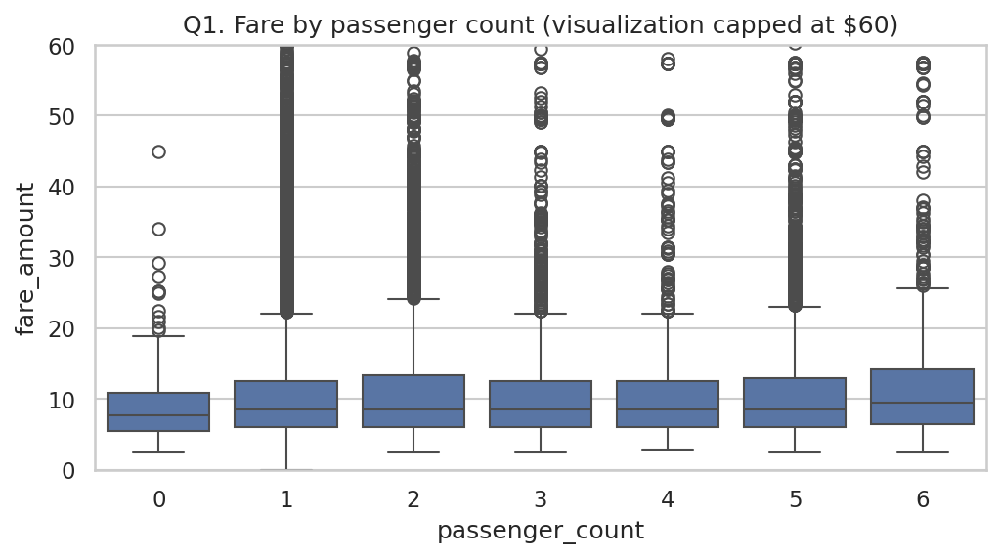
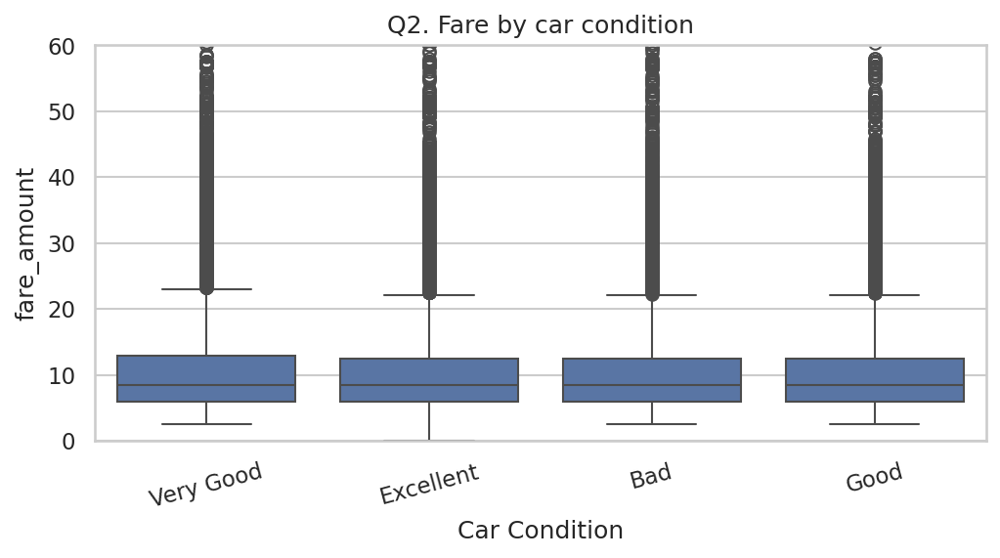
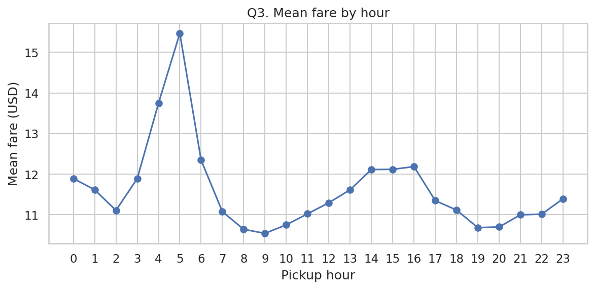
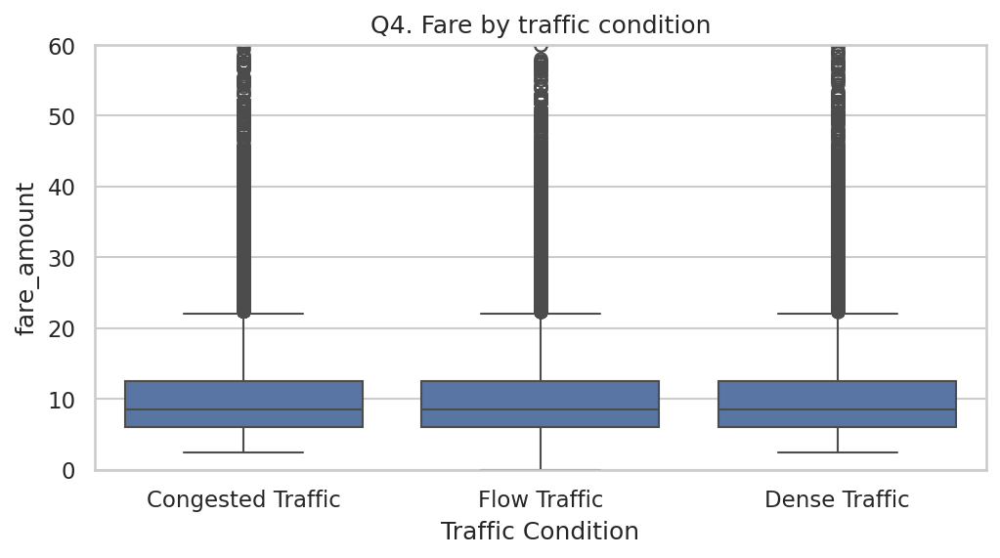
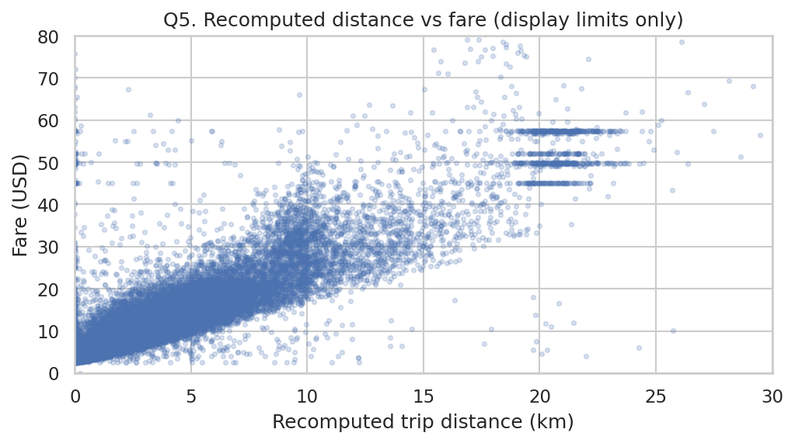
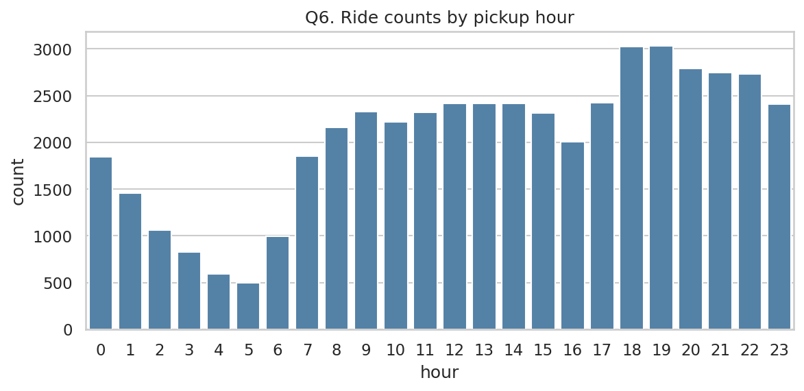
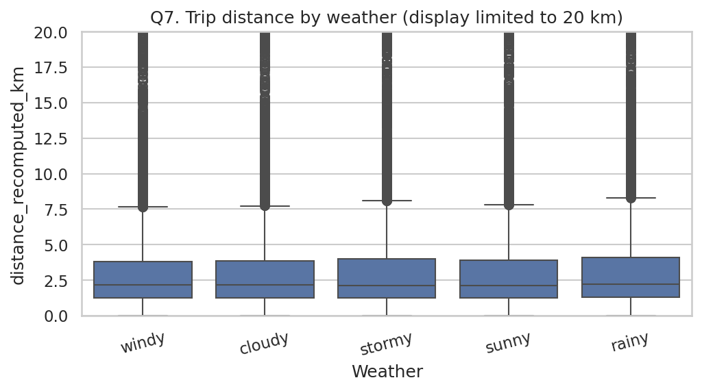
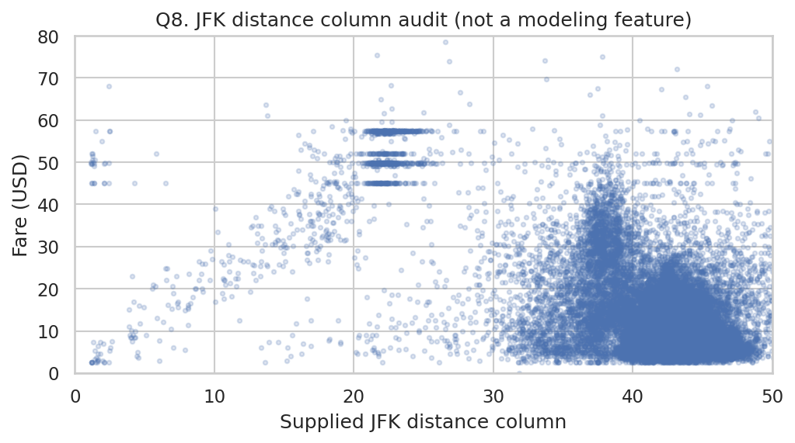

# Task 1 — Exploratory Data Analysis

## Dataset and cleaning notes

- Raw dataset: `50,000` rows × 26 columns.
- Rows retained by deterministic cleaning: 48,897; excluded: 1,103 (2.21%).
- Source coordinates were converted from radians to degrees before geographic checks.
- Rows with invalid NYC-area coordinates, zero-zero placeholders, non-positive fares, or unparseable timestamps were excluded for this analysis.
- No NaNs or exact duplicate rows were found in the raw file; repeated `key` values were not treated as duplicates because timestamps can collide.
- Fare plots use display limits only where noted; observations were not capped in the analysis data.
- The supplied airport/landmark distance fields are treated as suspect and are not used as trusted features. Q8 is framed as a data-quality investigation; distances should be recomputed from documented reference coordinates before modeling.

## Q1–Q8: question, plot choice, interpretation

### Q1. Does passenger count relate to fare?

**Plot choice:** Boxplot of fare by discrete passenger count. Compare medians/spread; fare can also depend heavily on trip distance, so this is not causal.

### Q2. Does car condition influence fare?

**Plot choice:** Boxplot by category. The categorical groups should be compared with a Kruskal–Wallis test because fare is skewed; no causal conclusion from group differences alone.

### Q3. At what hour are fares typically highest?

**Plot choice:** Line plot of mean fare by hour, accompanied by counts. Interpret with group sizes and potential airport/route mix.

### Q4. Does traffic condition relate to fare?

**Plot choice:** Boxplot by traffic category; use a nonparametric group comparison and be cautious if categories are synthetic or weakly associated.

### Q5. Is trip distance associated with fare?

**Plot choice:** Scatterplot of recomputed Haversine distance against fare. Visible display limits improve readability only; calculate Pearson and Spearman and later compare model permutation importance before claiming strongest predictor.

### Q6. When are ride requests most frequent?

**Plot choice:** Count plot by hour. This describes trip frequency, not fare level; consider hour × weekday heatmap as an extension.

### Q7. Does weather relate to trip distance?

**Plot choice:** Boxplot of recomputed distance by weather. Extreme trips can compress the central pattern, so the plot has a display limit and should be paired with group counts.

### Q8. Are trips starting closer to airports more expensive?

**Plot choice:** Initial audit plot of supplied JFK distance against fare. Because supplied airport distance columns are suspect, this plot is diagnostic only; recompute airport distances from documented reference points before drawing substantive conclusions.

## Extra questions to investigate

1. How does fare per kilometer vary by hour and year? Check zero-distance trips before calculating ratios.
2. Where are valid pickup locations concentrated? Use a geographic scatterplot after converting radians to degrees.
3. Do zero-distance trips have different fares or passenger counts? Inspect them rather than assuming they are invalid.
4. How do weekend and weekday fare distributions differ? Compare distributions and account for different trip mixes.
5. Does the fare distribution drift over years, and how well does a model trained on earlier years generalize to 2015?

## Reproducibility and limitations

- Run the notebook from the repository root after installing `requirements.txt`.
- The notebook derives date features from `pickup_datetime` rather than trusting stored derived columns.
- These charts are exploratory; preliminary associations are not causal claims.
- The 2015 observations cover only part of the year, and supplied airport/landmark distances need further validation.
